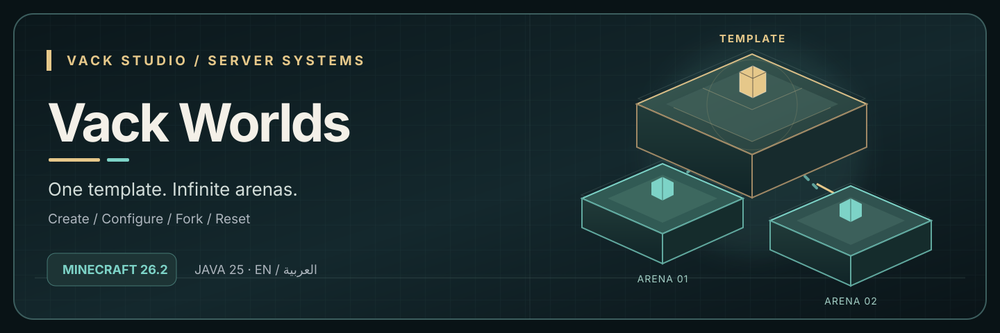

  

# Vack Worlds | Vack Studio

Create, configure, and fork Minecraft worlds for independent minigame rounds on VackMini 0.1.0 / Minecraft 26.2.

## Features

- Create flat or standard worlds, import existing map folders, and set teleport spawn.
- Save settings for PvP, difficulty, spawning, auto-load, and auto-save per world.
- Fork unloaded map templates in the background; unload and remove used round copies.
- A `WorldsApi` service for minigame plugins to fork, teleport, and clean up instances.
- English and Arabic command feedback with a UUID-persisted language choice.

## Requirements

Java 25 and VackMini 0.1.0 / Minecraft 26.2. Built against Paper API `26.2.build.130-stable`. Other server forks and Folia have not been verified. No additional plugin is required.

## Installation and usage

Download `VackWorlds-1.0.0.jar` from [Releases](https://github.com/zoiila/vack-worlds/releases). Place it in `plugins/` and restart the server. `config.yml` sets defaults and protected worlds. Give trusted staff `vackworlds.*` for all world commands, `vackworlds.admin` for management and teleport, or `vackworlds.teleport` for teleport alone. Run `/vworld help` for all commands or `/vworld language` for English / العربية.

Example: `/vworld create build_template NORMAL FLAT`, prepare the map, move everyone out, `/vworld unload build_template`, `/vworld fork build_template build_round_1`, `/vworld load build_round_1`. After a round, unload and use `/vworld delete build_round_1 confirm`.

## العربية

ضع `VackWorlds-1.0.0.jar` في `plugins/` وأعد تشغيل السيرفر. استخدم `/vworld help` للأوامر، و`/vworld language ar` لحفظ العربية. أنشئ خريطة بـ`/vworld create build_template NORMAL FLAT`، جهّزها، ثم أخرج اللاعبين واستخدم `/vworld unload build_template` و`/vworld fork build_template build_round_1` لإنشاء نسخة مستقلة للجولة.

## Validation and limitations

Java 25 Gradle build completed against Paper 26.2 API. The provided VackMini server identified itself as 0.1.0 / 26.2; the isolated test environment prevented server socket binding before plugin activation. A live server acceptance run, including two mixed-language players, remains to be done. The Java service exposes lifecycle operations; automatic minigame rules and player restoration are outside this plugin.

Developed by Vack Studio.  
Copyright (c) Vack Studio. All rights reserved.
